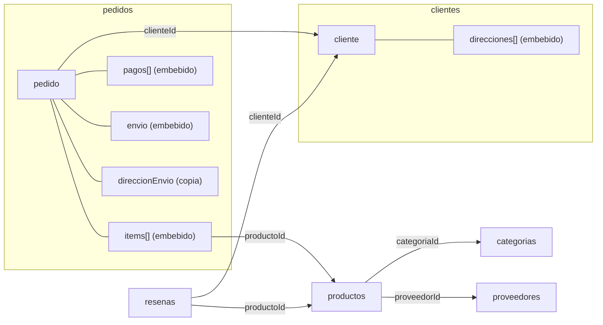

# Modelo documental – Tienda en línea (MongoDB)

Base de datos: `tienda_online` · 10 tablas SQL → 6 colecciones.

## Correspondencia tablas → colecciones

| Tablas SQL | Colección | Técnica |
|---|---|---|
| Categoria | `categorias` | Colección independiente, referenciada desde `productos` |
| Proveedor | `proveedores` | Colección independiente, referenciada desde `productos` |
| Producto | `productos` | Referencias `categoriaId` y `proveedorId` |
| Cliente + Direccion | `clientes` | `direcciones[]` embebidas |
| Pedido + DetallePedido + Pago + Envio | `pedidos` | `items[]`, `pagos[]` y `envio` embebidos; copia de la dirección en `direccionEnvio`; referencias `clienteId` e `items[].productoId` |
| Resena | `resenas` | Referencias `productoId` y `clienteId` |

## Diagrama



Líneas `---`: embebido (el dato vive dentro del documento). Flechas `-->`: referencia (solo se guarda el id).

## Criterios de decisión

Para cada tabla se respondieron cuatro preguntas: ¿se lee siempre junto con su padre?, ¿tiene vida propia?, ¿cuántos elementos son (acotado o sin límite)?, ¿lo usan varias entidades?

| Dato | Decisión | Justificación |
|---|---|---|
| DetallePedido | Embebido en `pedidos.items[]` | No existe sin el pedido, se lee con él y son 1 a 5 por pedido |
| Pago | Embebido en `pedidos.pagos[]` | Pertenece al pedido; 1 o 2 por pedido |
| Envio | Embebido en `pedidos.envio` (objeto o `null`) | Relación 1:0..1, siempre se consulta con el pedido |
| Direccion | Embebida en `clientes.direcciones[]` | 1 o 2 por cliente, sin vida propia |
| Dirección del pedido | Copia en `pedidos.direccionEnvio` | Dato histórico: conserva a dónde se envió aunque el cliente cambie su dirección |
| Cliente | Referenciado (`clienteId`) | Tiene vida propia y muchos pedidos; embeber los pedidos en el cliente crecería sin límite (máx. 16 MB por documento) |
| Producto | Referenciado (`productoId`) + copia del `nombre` | Se usa en miles de items y su precio y stock cambian; la copia del nombre (referencia extendida) evita un `$lookup` al ver el detalle |
| Categoria, Proveedor | Referenciados | Catálogos compartidos por 300 productos; se modifican en un solo lugar |
| Resena | Colección propia | Pertenece a producto y cliente a la vez, crece sin límite y se consulta de forma independiente |

## Decisiones de transformación

| Decisión | Justificación |
|---|---|
| `_id` = id de SQL Server | Permite verificar 1 a 1 y mantiene válidas las referencias |
| `Decimal128` para valores monetarios | Exacto como `DECIMAL`; `double` es aproximado |
| Nombres en `camelCase` | Convención de MongoDB |
| `envio: null` si no hay envío | Estructura uniforme en todos los pedidos |
| `DATE` → `ISODate` (medianoche) | MongoDB no tiene tipo solo-fecha |
| `BIT` → `true` / `false` | Booleano nativo |
| `idDireccion`, `idPago`, `idEnvio` dentro de los embebidos | Trazabilidad para la verificación |

## Ejemplo de documento `pedidos`

```javascript
{
  _id: 150,
  clienteId: 37,
  fechaPedido: ISODate("2025-08-14T10:23:00Z"),
  estado: "Entregado",
  total: Decimal128("412300.00"),
  direccionEnvio: {
    idDireccion: 37,
    alias: "Casa",
    direccion: "Calle 45 # 12 - 30",
    ciudad: "Medellín",
    departamento: "Antioquia"
  },
  items: [
    {
      productoId: 88,
      nombre: "Tapete de yoga Pro",
      cantidad: 2,
      precioUnitario: Decimal128("106400.00"),
      descuento: Decimal128("0.00")
    }
  ],
  pagos: [
    {
      idPago: 302,
      fechaPago: ISODate("2025-08-14T11:40:00Z"),
      metodo: "Nequi",
      valor: Decimal128("412300.00"),
      estado: "Aprobado"
    }
  ],
  envio: {
    idEnvio: 140,
    transportadora: "Servientrega",
    numeroGuia: "SER0000150",
    fechaEnvio: ISODate("2025-08-15T14:00:00Z"),
    fechaEntrega: ISODate("2025-08-18T09:00:00Z"),
    estado: "Entregado"
  }
}
```

(Valores ilustrativos; los documentos reales están en `evidencias/`.)

## Cómo se comprobará que no se pierde información

- Filas de DetallePedido = suma del tamaño de todos los `items` (5.190).
- Filas de Pago = suma del tamaño de todos los `pagos` (2.184).
- Filas de Envio = pedidos con `envio` distinto de `null` (1.896).
- Filas de Direccion = suma del tamaño de todas las `direcciones` (1.000).
- El `total` de cada pedido coincide con la suma de sus items.
- Toda referencia (`clienteId`, `productoId`, `categoriaId`, `proveedorId`) existe en su colección.