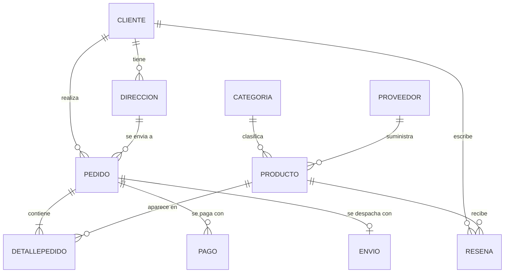

# Modelo relacional – Tienda en línea

## Entidades

| # | Tabla | Descripción | Registros aprox. |
|---|---|---|---|
| 1 | Categoria | Clasificación de productos | 10 |
| 2 | Proveedor | Empresas que suministran productos | 15 |
| 3 | Producto | Artículos a la venta | 300 |
| 4 | Cliente | Compradores registrados | 800 |
| 5 | Direccion | Direcciones de envío de cada cliente | 1.000 |
| 6 | Pedido | Compra realizada por un cliente | 2.000 |
| 7 | DetallePedido | Productos incluidos en cada pedido | 5.500 |
| 8 | Pago | Intentos de pago de un pedido | 2.200 |
| 9 | Envio | Despacho de un pedido | 1.900 |
| 10 | Resena | Calificación de un cliente a un producto | 1.200 |

Total aproximado: 14.900 registros.

## Diagrama entidad-relación

## Relaciones

| Relación | Cardinalidad | Implementación |
|---|---|---|
| Categoria – Producto | 1 : N | FK `Producto.id_categoria` |
| Proveedor – Producto | 1 : N | FK `Producto.id_proveedor` |
| Cliente – Direccion | 1 : N | FK `Direccion.id_cliente` |
| Cliente – Pedido | 1 : N | FK `Pedido.id_cliente` |
| Direccion – Pedido | 1 : N | FK compuesta `Pedido(id_direccion, id_cliente)` |
| Pedido – Producto | N : M | Tabla intermedia `DetallePedido` |
| Pedido – Pago | 1 : N | FK `Pago.id_pedido` |
| Pedido – Envio | 1 : 0..1 | FK `Envio.id_pedido` con UNIQUE |
| Cliente – Producto (reseña) | N : M | Tabla `Resena`, UNIQUE (id_cliente, id_producto) |

## Decisiones de diseño

1. **`precio_unitario` en DetallePedido:** guarda el precio histórico de la venta, porque `Producto.precio` puede cambiar.
2. **PK compuesta en DetallePedido (id_pedido, id_producto):** un producto aparece una sola vez por pedido; las unidades van en `cantidad`.
3. **Pago 1:N y Envio 1:0..1:** un pedido puede tener varios intentos de pago, pero se despacha una sola vez.
4. **`total` almacenado en Pedido:** desnormalización controlada; agiliza reportes y se usa para verificar la migración.
5. **Direccion como tabla:** un cliente tiene varias direcciones (1FN).
6. **FK compuesta (id_direccion, id_cliente):** impide asignar a un pedido la dirección de otro cliente.

## Reglas de coherencia de los datos

- Estados de pedido: Pendiente, Pagado, Enviado, Entregado, Cancelado.
- Solo los pedidos Enviados o Entregados tienen envío; solo los Entregados tienen `fecha_entrega`.
- Todo pedido que no esté Pendiente tiene al menos un pago Aprobado.
- `total` = Σ (cantidad × precio_unitario − descuento) de sus detalles.
- Un cliente solo reseña productos que compró en un pedido Entregado.